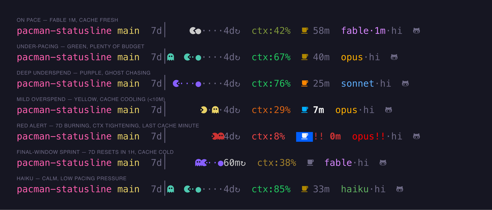

# pacman-statusline

A Pac-Man themed status line for [Claude Code](https://claude.com/claude-code).



A mildy opinionated Pac-man theme for Claude's status line. Designed around two goals:

- Using (eating) weekly quota, but not running out (dying).
- Staying out of the 'dumb zone' of context with Claude.

Objects:

- **Pac-man** — sits at your current usage in the window
- **Power pellet** — a burn pacer dot which is the ratio of time elapsed (the target).
- **Dots** between pac and the pellet, quota budget you can safely munch on. 
- **Dim dots** past the pellet, anticipated budget beyond the pacer.
- **Ghost** — appears behind pac when you're under-consuming (move faster), or ahead of pac when you're over-spending (a warning)
- **Reset timer** — time until the window refills (e.g. `3h↻`, `4d↻`). It turns white when pac or the pellet sits in the last cell.

When you outpace the budget, pac flips around (left-facing) and retreats past the pellet. The pacing tier escalates from neutral → yellow
→ red as the overspend gets worse.

### 7-day pacing

The weekly quota is "use it or lose it", but it resets weekly. The rules assume
you want to burn through it by the end of the week: being *ahead* of the
pellet should feel bad, being far *behind* it should feel wasteful.

Overspending is scored worst early in the week (it compounds) and underspending
worst late (it's wasted). The ghost closes in as the score worsens: green sits 4→3 cells behind
pac, purple 3→1 behind, yellow 3→1 ahead, and red is adjacent.

## Segments

```
repo  branch  7d-gauge  ctx  cache  model  [git-stats]
```

- **repo** — current directory, colored by a stable hash of the repo name. CWD if not in a repo.
- **branch** — yellow for `main`/`master`, cyan for feature branches
- **7d gauge** — discussed above, 10-cell pac-man bar + reset timer
- **ctx** — context window remaining, autocompact-aware, with a quality-budget display for 1M-context models. 
  - Autocompact-aware: 15% (200K models) or 17% (1M models) is reserved for compaction, so `0%` means compaction fires.
- **cache** — prompt-cache countdown: a coffee cup plus the minutes left before the cache goes cold, laid out as `cup !! minutes`. Quiet while healthy (dim amber, then orange from 30m). Cool colors mean "about to go cold" (red would read as hot): blue cup from 10m, white cup on a blue background from 5m, and red `!!` with a red number only under 2m. The minutes never get a background. Minutes are floored, so `1m` always has at least 60s left and the final minute reads `0m`. A dim gray cup means cold. Hidden when Claude Code reports no cache data. Thresholds scale down for a 5m TTL (blue 2m, background 1m, `!!` 30s).
- **model** — fable/opus/sonnet/haiku tier (from `model.id`), 1M flag (from the context window size), and the session's effort level. Turns red with `!!` when 7d is in danger.
- **git-stats** — current repo only: `⎇` linked worktree, `!N` modified/staged, `?N` untracked, `Nf +N -N` diffstat against HEAD

## Install

macOS. Requires [`uv`](https://docs.astral.sh/uv/) and `curl`.

**1. Clone the repo and patch the font.**

```bash
git clone https://github.com/kam-hak/pacman-statusline.git
cd pacman-statusline
./install.sh
```

Keep the clone somewhere stable. Claude Code will reference
`statusline-command.sh` from the cloned directory in step 2.

The installer is only for one custom font, the reversed Pac who is 'running away'.

- Downloads MesloLGS NF (all 4 weights) into `~/Library/Fonts/` if missing
- Backs up the pristine fonts as `*.ttf.bak`, then patches each with a
  horizontally-mirrored pac-man glyph inserted at the first free PUA-A
  codepoint above U+F1000
- Writes the chosen codepoint to `~/.config/pacman-statusline/config`

Restart your terminal afterwards so the patched font reloads.

**2. Point Claude Code at the script.**

In Claude Code, run:

```
/statusline
```

and paste the absolute path to `statusline-command.sh` in this repo. Claude
Code records the path in `~/.claude/settings.json` and picks up edits to the
script live — no copy or symlink required.

**3. Keep the cache countdown ticking while idle (recommended).**

The status line only re-runs on events (a new message, etc.), so while you're
away the countdown freezes. In the `statusLine` block of `~/.claude/settings.json`
add `refreshInterval`:

```json
"statusLine": { "type": "command", "command": "/path/to/statusline-command.sh", "refreshInterval": 60 }
```

It's a local timer that re-runs the script; nothing touches the network or
your quota.

### Font

The right-facing pac-man (U+F0BAF) and ghost (U+F02A0) are native to Nerd
Fonts. A left-facing pac-man does not exist, so `install.sh`
generates one by reflecting U+F0BAF across its advance width and inserting
the result at a free codepoint picked per-machine (recorded in the config
file above). SVG reference glyphs extracted from a live patched font live
in `assets/` for documentation; the installer reproduces them from scratch
and does not consume them.

## Tests

`tests/matrix.sh` renders the statusline under ~70 synthetic JSON fixtures —
7d tiers, overspend, ghost positions, context gradient, model variants,
prompt-cache countdown (1h and 5m TTL), final-window sprint, git states, and
degenerate inputs. Run it to eyeball the
full visual state space after any change:

```bash
bash tests/matrix.sh
```

## Regenerating the mockup

```bash
uv run python3 scripts/render-mockup.py
```

Needs `rsvg-convert` (`brew install librsvg`) and `MesloLGS NF Regular.ttf` in
`~/Library/Fonts/`. It renders the SVG (gitignored, embeds the font) and rasterizes it to
`assets/mockup.png`, which is the committed file: GitHub strips `<style>` from SVGs, which
breaks the embedded font.

## Implementation notes

- Claude Code gives statusline commands no terminal width, so output is not width-aware.
- bash 3.2 has no `\U` escape, so the left-pac glyph is built from `\xNN` bytes.
- `scripts/patch-font.py` prints the chosen codepoint on its last line because `install.sh` reads it with `tail -n1`.

## Architecture

The script is organized into "types," each owning a namespaced state prefix
and a family of functions:

| Type      | State prefix | Responsibility                                      |
|-----------|--------------|-----------------------------------------------------|
| `Input`   | `IN_*`         | Parse JSON once, narrow into typed fields           |
| `Repo`    | `REPO_*`       | Location, branch, hashed color                      |
| `Window`  | `W7_*`         | Asymmetric pacing score for the 7d window           |
| `Pacman`  | `PAC7_*`       | Score/color/direction bundle                        |
| `Gauge`   | —              | Stateless pac-man bar renderer                      |
| `Context` | `CTX_*`        | Autocompact-aware meter + quality budget            |
| `Cache`   | `CACHE_*`      | Prompt-cache countdown (coffee cup, cools toward expiry) |
| `Model`   | `MODEL_*`      | Tier, 1M flag, effort, 7d alert                     |
| `Git`     | `GIT_*`        | Dirty counts and diffstat                           |

`main()` at the bottom reads like prose: parse → compute → render.

## License

MIT — see [LICENSE](LICENSE).
